

<picture><source media="(prefers-color-scheme: dark)" srcset="assets/hero-dark.svg"></picture>

<picture><source media="(prefers-color-scheme: dark)" srcset="assets/stack-dark.svg"></picture>

<picture><source media="(prefers-color-scheme: dark)" srcset="assets/about-dark.svg"></picture>

<picture><source media="(prefers-color-scheme: dark)" srcset="assets/stats-dark.svg"></picture>

<picture><source media="(prefers-color-scheme: dark)" srcset="assets/button-l-dark.svg"></picture><a href="https://github.com/omar-haidar?tab=repositories"><picture><source media="(prefers-color-scheme: dark)" srcset="assets/button-1-dark.svg"></picture></a><a href="https://t.me/OMAR_HAIDAR_0"><picture><source media="(prefers-color-scheme: dark)" srcset="assets/button-2-dark.svg"></picture></a><picture><source media="(prefers-color-scheme: dark)" srcset="assets/button-r-dark.svg"></picture>

<a href="https://github.com/omar-haidar/cog-plugin-examples"><picture><source media="(prefers-color-scheme: dark)" srcset="assets/project-cog-plugin-examples-dark.svg"></picture></a>&nbsp;<a href="https://github.com/omar-haidar/IconsRepository-Plugin"><picture><source media="(prefers-color-scheme: dark)" srcset="assets/project-iconsrepository-plugin-dark.svg"></picture></a>

<a href="https://github.com/omar-haidar/Android-Netty-Proxy"><picture><source media="(prefers-color-scheme: dark)" srcset="assets/project-android-netty-proxy-dark.svg"></picture></a>&nbsp;<a href="https://github.com/omar-haidar/MaterialNote"><picture><source media="(prefers-color-scheme: dark)" srcset="assets/project-materialnote-dark.svg"></picture></a>

<a href="https://github.com/omar-haidar/OMH-Language"><picture><source media="(prefers-color-scheme: dark)" srcset="assets/project-omh-language-dark.svg"></picture></a>&nbsp;<a href="https://github.com/omar-haidar/Sketchware-Pro"><picture><source media="(prefers-color-scheme: dark)" srcset="assets/project-sketchware-pro-dark.svg"></picture></a>

<picture><source media="(prefers-color-scheme: dark)" srcset="assets/wave-dark.svg"></picture>

<picture><source media="(prefers-color-scheme: dark)" srcset="assets/streak-dark.svg"></picture>

<a href="https://metawka.github.io/expressive-profile/?from=omar-haidar"><picture><source media="(prefers-color-scheme: dark)" srcset="assets/credit-dark.svg"></picture></a>

